# Magic Bot Workshop 🪄🤖

**Created by Megaspy 🦄🕵️ (age 7)**: all the ideas, names and picks are hers. A grown-up helper and Claude did the typing.

A kid's **vibe coding** workshop: she dreams up ideas for her robot **Sparkle**, picks from moving pick-a-number
pages, and watches them come alive on a Seeed XIAO ESP32S3 Sense (camera, mic, motion sensor, tiny OLED screen).
Shared in the hope that other families find it useful. See the **[course](course/README.md)**.

<p align="center">
  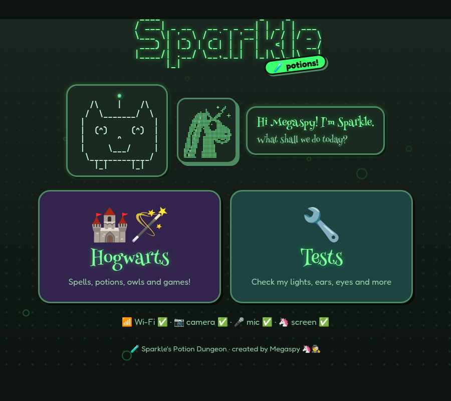
  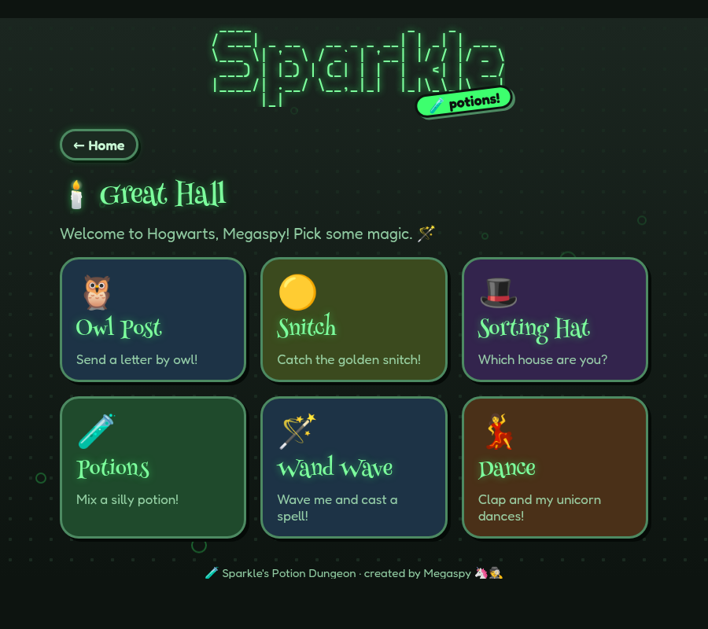
  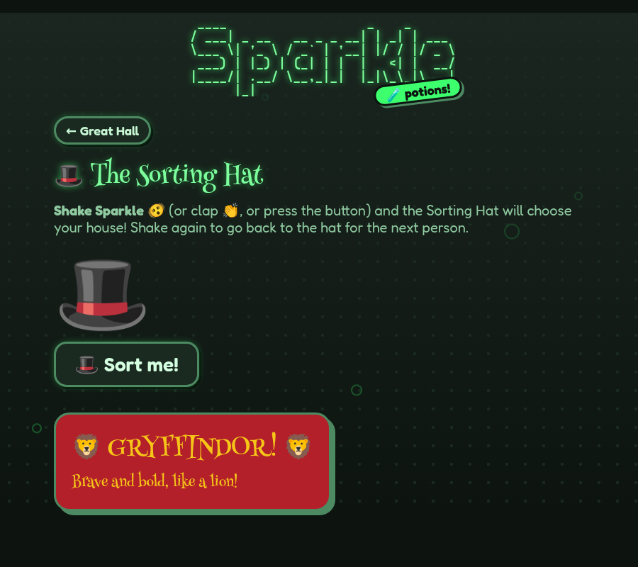
</p>

## 🏰 What Sparkle can do

Every game has a page on Sparkle's web site (http://sparkle.local) **and** shows up on its tiny 72×40 screen.

| | | |
|:-:|:-:|:-:|
| 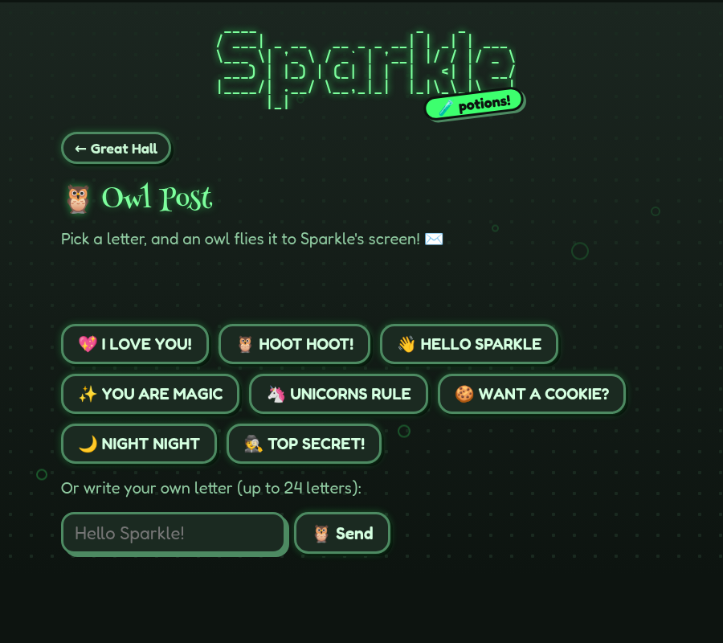<br>🦉 **Owl Post**: an owl flies a letter onto Sparkle's screen | 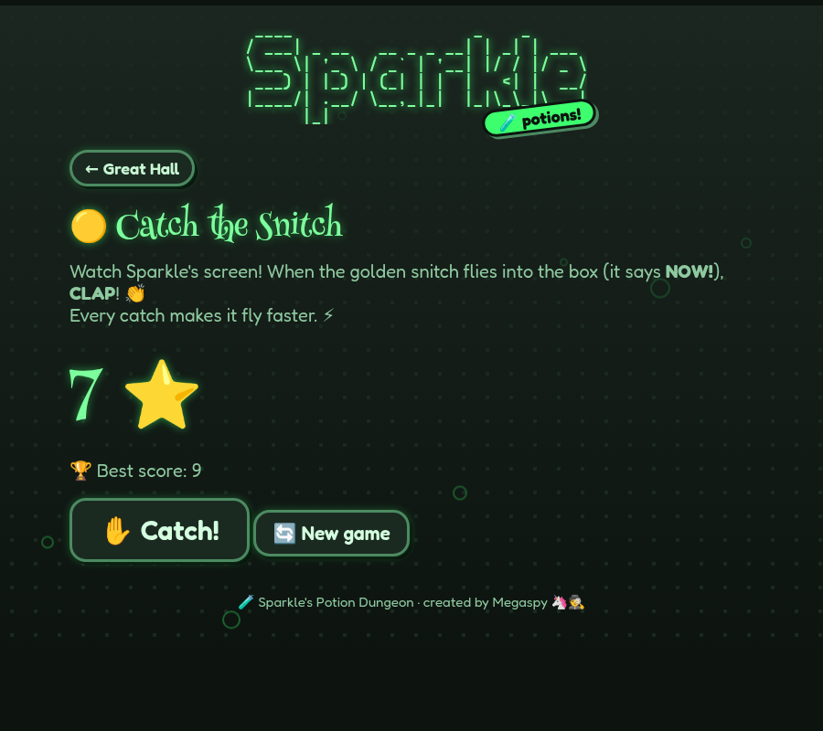<br>🟡 **Catch the Snitch**: clap when it's in the box (with Megaspy's 2-second rule) | <br>🎩 **Sorting Hat**: shake Sparkle to be sorted |
| 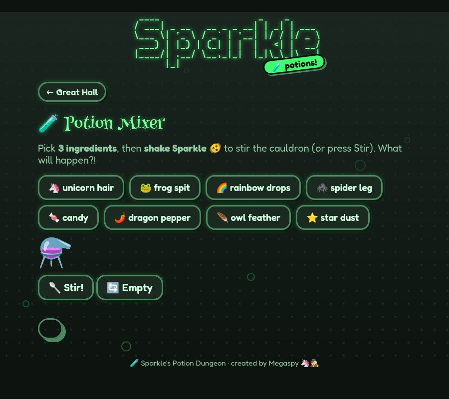<br>🧪 **Potion Mixer**: 3 ingredients, shake to stir, 12 potions to find | 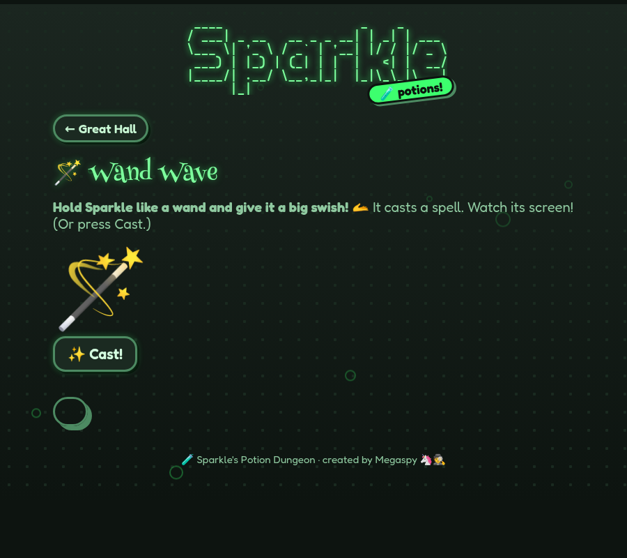<br>🪄 **Wand Wave**: swish Sparkle to cast Lumos, Accio, Leviosa… | 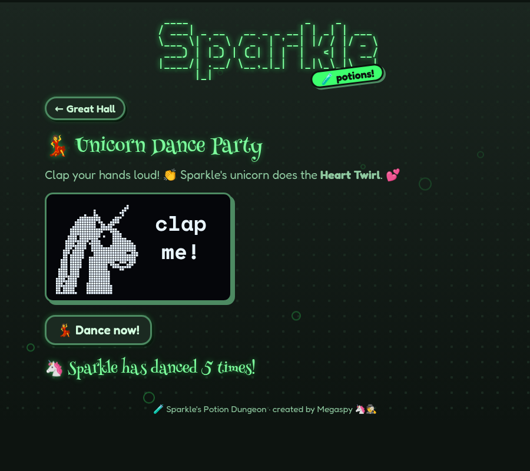<br>💃 **Dance**: clap and the unicorn does the Heart Twirl |

Plus a 🔧 **Tests** menu (lights, sounds, camera, screen, memory card, Wi-Fi) and a 📺 **Spy Camera** on a second
board, the "Cheap Yellow Display", that shows Sparkle's camera over Wi-Fi.

## 📱 Sparkle's Remote (the yellow touchscreen)

A "Cheap Yellow Display" (ESP32 + 2.8" colour touchscreen) is Sparkle's remote: tap a game and Sparkle switches to it,
while the yellow screen shows the colourful part (house crests, spell names, potion pictures, a Quidditch pitch, letters
from Sparkle). The action still happens on Sparkle: you shake it, clap at it, swish it like a wand.

<p align="center">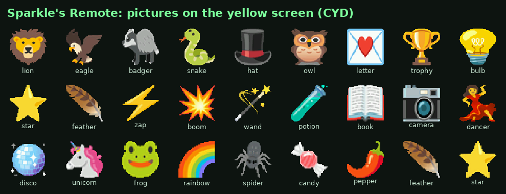</p>

Code: [`firmware/cyd/cyd_menu`](firmware/cyd/cyd_menu). Pictures are made from Noto Color Emoji by
[`tools/emoji_icons.py`](tools/emoji_icons.py). The house crests are our own shields with animals, not the official ones.

## 🎨 How she decides: pick-a-number pages

Every choice is a page of numbered, **moving** previews with a 🔊 button that reads it aloud. She says a number;
Claude builds it.

| | |
|:-:|:-:|
| 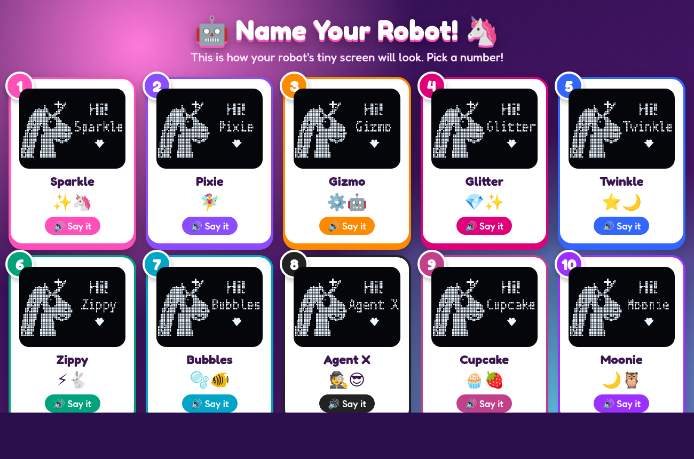<br>**Name the robot** (she picked 1: Sparkle) | 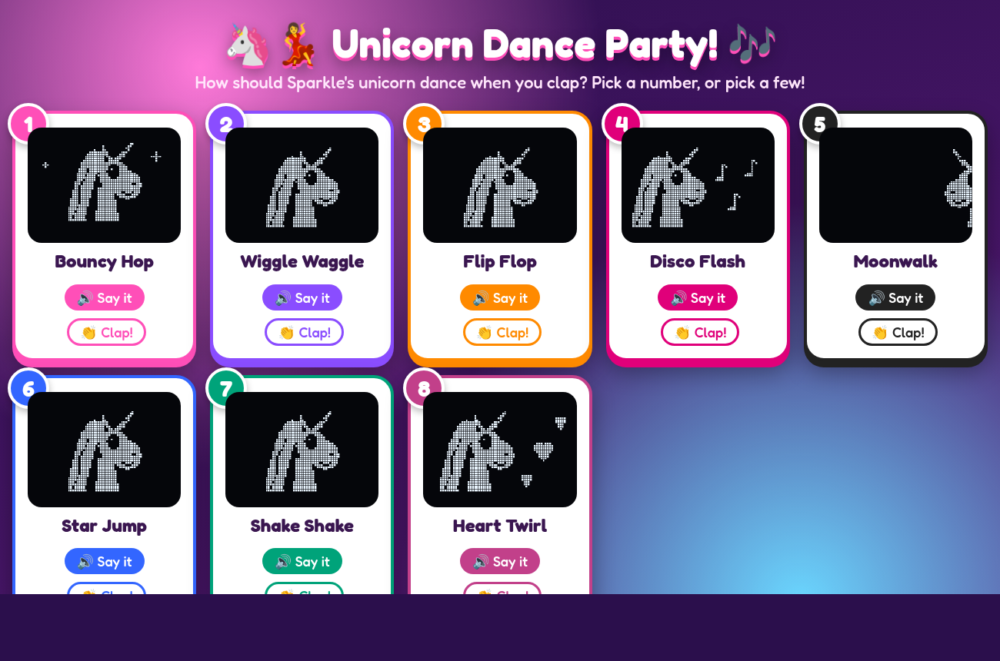<br>**Unicorn Dance Party** (picked 8: Heart Twirl) |
| 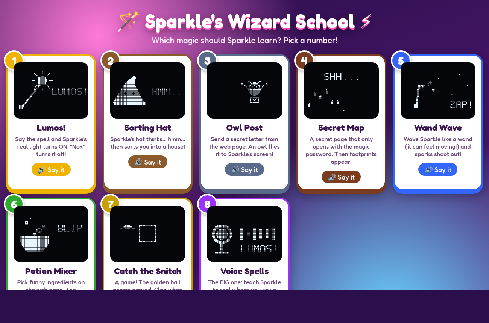<br>**Wizard School** (picked Owl Post, Snitch, Sorting Hat, Potions, Wand Wave) | 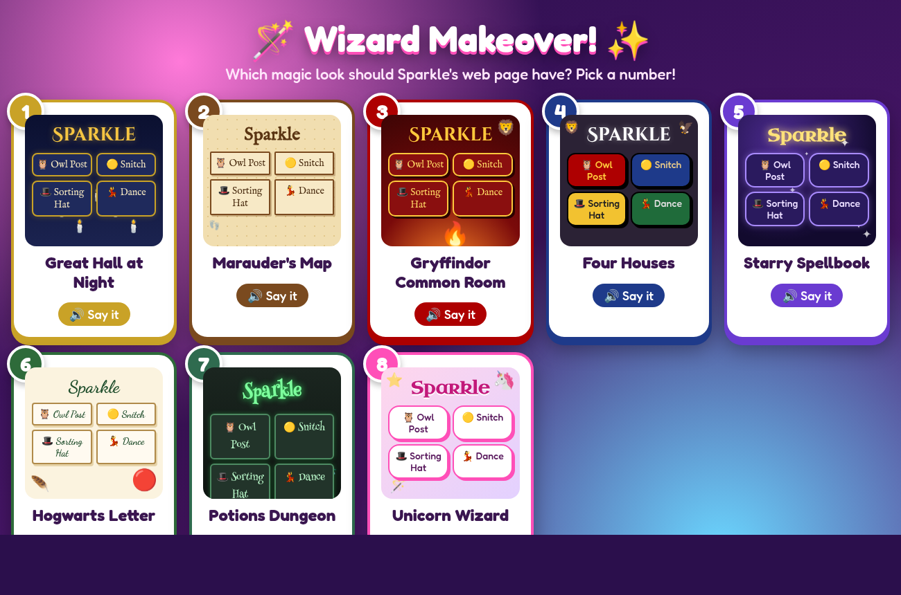<br>**Wizard Makeover** (picked 7: Potions Dungeon) |
| 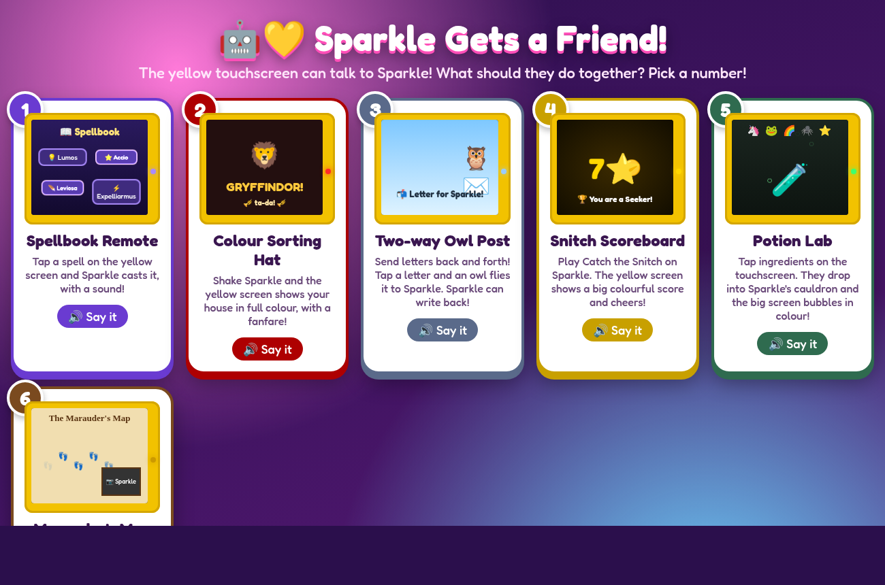<br>**Sparkle Gets a Friend** (coming next) | 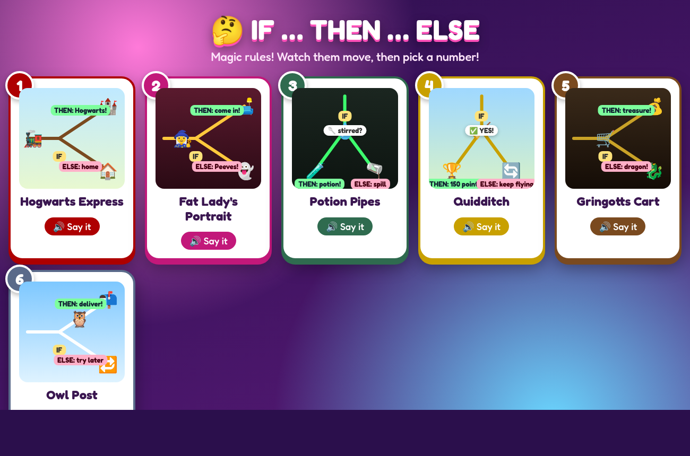<br>**IF … THEN … ELSE** (for her logic lessons) |

All the pages: [pickers/](pickers/). Her ideas, picks and badges: **[IDEAS.md](IDEAS.md)**.

## 📚 Course: Vibe Coding for Kids
- **[course/README.md](course/README.md)**: the method and 13 labs built from these sessions
- **[course/prompts-costar.md](course/prompts-costar.md)**: the real prompts, in CO-STAR form
- **[course/equipment.md](course/equipment.md)**: what we used, and the gotchas
- **[LEARNING.md](LEARNING.md)**: her logic roadmap (IF/THEN/ELSE, trying again, friends & feelings)

## ▶️ Start a session

```bash
cd ~/workstation/github/604Security/magic-bot-workshop
claude
```
Then type **`/sparkle`**. Claude checks the robot, opens its web page, and asks her for the next idea.

- Flash Sparkle: `make petbot-test` (or `make flash-safe SKETCH=firmware/petbot_test` with a flaky cable)
- Flash the yellow screen: `make cyd-flash CYD_SKETCH=firmware/cyd/cyd_spycam`

Started from `ai-petbot`. See [CLAUDE.md](CLAUDE.md) for hardware, toolchain, and the kid-mode rules.

_Screenshots use demo values (her spy name, no network details)._

## Licence
- **Code:** MIT ([LICENSE](LICENSE))
- **Course, ideas, pick-a-number designs and screenshots:** CC BY 4.0 ([course/LICENSE.md](course/LICENSE.md)).
  Please credit **Megaspy**.

Harry Potter names are used here for a family's private fun and learning; this project has no connection with the
Harry Potter books, films or their owners.
